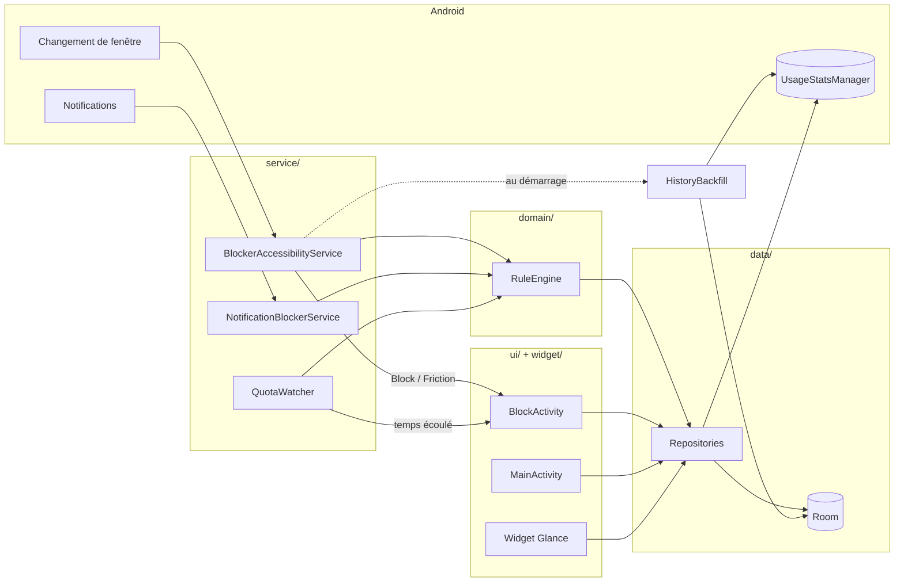
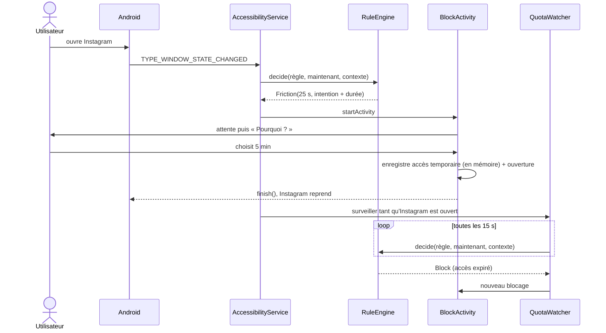

# Architecture du code d'Antiscrolling

*Appli Android · conception technique*

Comment organiser le code pour couvrir toutes les fonctionnalités retenues : blocage, frictions, statistiques et motivation, sans réécriture entre le MVP et la version complète, et publiable sur le Play Store.

- Langage : **Kotlin**
- UI : **Jetpack Compose**
- minSdk : **28**
- Modules Gradle : **1**
- Distribution : **Play Store**

## Principes

- **Une décision, un seul endroit.** Toutes les règles (quota, horaires, focus, frictions) sont évaluées par une fonction Kotlin pure, `RuleEngine.decide()`. Elle ne dépend pas d'Android, donc elle se teste en JUnit simple.
- **Android mesure, on ne duplique pas.** Le temps passé et les déverrouillages viennent de `UsageStatsManager`. On ne stocke que ce qu'Android ne garde pas longtemps : un résumé par jour, rattrapé au démarrage du service.
- **Tout en mémoire.** Le service lit les règles et les accès temporaires en mémoire (`StateFlow`). Aucune requête en base ni dans UsageStats à chaque changement d'appli. Les écritures en base suivent, en arrière-plan.
- **Pas de framework en trop.** Un seul module Gradle, une injection de dépendances manuelle (`AppContainer`), ni WorkManager ni DataStore. Hilt ou le multi-module pourront venir si l'appli grossit.
- **Rien ne quitte le téléphone.** Pas de permission `INTERNET`, et `allowBackup="false"` pour éviter la sauvegarde Google Drive. Les données restent sur l'appareil, ce qui simplifie la déclaration d'accessibilité et le formulaire « Sécurité des données » du Play Store.

## Vue d'ensemble

Trois services système alimentent le moteur de règles. L'interface et le widget lisent les mêmes repositories.



## Organisation des packages

Découpage par couche : `domain` ne connaît rien d'Android, `data` parle à Room et au système, `service` et `ui` sont les points d'entrée.

```
app/src/main/java/com/antiscrolling/
├── App.kt                         // Application, crée l'AppContainer
├── AppContainer.kt                // injection manuelle : DB, repositories, engine
│
├── domain/                        // Kotlin pur, 100 % testable
│   ├── Rule.kt                    // Rule (réglages et frictions), Schedule, FocusSession
│   ├── Profile.kt                 // Profile, RuleSet (règles de chaque profil, profil actif)
│   ├── Decision.kt                // Allow / Block / Friction
│   ├── Friction.kt                // Step, tâches, enchaînement des frictions (FrictionProgress), OpenEvent
│   ├── RuleEngine.kt              // decide(règle, now, contexte)
│   ├── UsageCalculator.kt         // temps du jour à partir des événements UsageStats
│   └── StatsCalculator.kt         // séries, comparaison hebdo
│
├── data/
│   ├── db/                        // AppDatabase, entités, DAO Room
│   ├── RuleRepository.kt          // règles + horaires + focus, exposés en StateFlow
│   ├── UsageRepository.kt         // lecture UsageStatsManager
│   ├── EventRepository.kt         // ouvertures, intentions ; accès temporaires en mémoire, écrits en arrière-plan
│   ├── HistoryBackfill.kt         // recopie dans Room les jours manquants
│   └── InstalledApps.kt           // liste des applis lançables
│
├── service/
│   ├── BlockerAccessibilityService.kt
│   ├── NotificationBlockerService.kt
│   └── QuotaWatcher.kt            // rappelle decide() toutes les 15 s pendant qu'une appli suivie est ouverte
│
├── ui/
│   ├── MainActivity.kt            // onboarding puis onglets Aujourd'hui / Applis / Profils / Focus / Stats
│   ├── Neon.kt                    // style néon : couleurs, cadres, boutons, grilles de choix, icônes d'applis
│   ├── onboarding/                // écran d'information + consentement, puis permissions
│   ├── home/                      // temps du jour ; options, ouvertures et raisons des applis freinées
│   ├── apps/                      // choix des applis suivies
│   ├── rules/                     // réglages d'une appli (RuleScreen) et ses plages
│   ├── profiles/                  // profils et leurs horaires
│   ├── focus/                     // lancer un mode focus
│   ├── stats/                     // semaine, séries, ouvertures
│   └── block/
│       ├── BlockActivity.kt       // écran affiché par-dessus l'appli
│       └── steps/                 // DelayStep, IntentStep, TaskStep, DurationStep
│
├── widget/TimeLeftWidget.kt       // Glance
└── notif/Notifier.kt              // alerte « 5 min restantes »
```

## Composants système

| Composant | Type Android | Rôle |
|---|---|---|
| BlockerAccessibilityService | `AccessibilityService` | Reçoit `TYPE_WINDOW_STATE_CHANGED`, ne garde que les événements dont `className` est une vraie Activity, en déduit l'appli au premier plan, appelle le moteur et lance `BlockActivity` si besoin. Ne lit jamais le contenu des écrans (`canRetrieveWindowContent="false"`) : choix assumé, on bloque l'appli entière, pas seulement les Reels ou les Shorts. |
| BlockActivity | Activity plein écran | Affiche le blocage ou la suite de frictions. `excludeFromRecents`, `taskAffinity` séparée. « Retour » ou « Renoncer » ramène à l'écran d'accueil. |
| QuotaWatcher | Coroutine dans le service | Tant qu'une appli suivie est au premier plan et l'écran allumé, rappelle `decide()` toutes les 15 s, avec `usedTodayMs` = temps au début de la session + temps écoulé. Réévalue aussi au déverrouillage (`ACTION_USER_PRESENT`). Envoie l'alerte « 5 min restantes ». |
| NotificationBlockerService | `NotificationListenerService` | Met en attente (`snoozeNotification`) les notifications d'une appli bloquée jusqu'à la fin du blocage, au lieu de les supprimer. |
| HistoryBackfill | Fonction appelée au démarrage du service et à l'ouverture des stats | Recopie dans Room tous les jours manquants encore disponibles dans UsageStats (temps par appli, déverrouillages). Sans doublon, donc un jour raté se rattrape. |
| TimeLeftWidget | Glance `AppWidget` | Affiche le temps restant. Rafraîchi chaque minute par le service d'accessibilité pendant l'usage de l'appli affichée, et quand on change l'appli affichée. Android le relance aussi toutes les 30 min. |

## Le moteur de règles

Une seule fonction reçoit tout ce dont elle a besoin et rend une décision. Les règles sont vérifiées dans un ordre fixe : la première qui s'applique gagne.

```kotlin
sealed interface Decision {
    data object Allow : Decision
    data class Block(val reason: Reason) : Decision          // FOCUS, SCHEDULE, QUOTA
    data class Friction(val delaySec: Int, val steps: List<Step>) : Decision
}

data class Context(
    val usedTodayMs: Long,        // début de session (UsageCalculator) + temps écoulé
    val grantUntil: Instant?,     // accès temporaire « 5 min », lu en mémoire
    val focus: FocusSession?,     // dernière session lancée, active ou non
    val opensToday: Int = 0,      // ouvertures accordées aujourd'hui (open_event), pour le délai croissant
)

fun decide(rule: Rule?, now: ZonedDateTime, ctx: Context): Decision = when {
    rule == null || !rule.enabled                        -> Decision.Allow
    ctx.focus?.isActive(now) == true                     -> Decision.Block(Reason.FOCUS)
    rule.schedules.any { it.contains(now) }              -> Decision.Block(Reason.SCHEDULE)
    rule.quotaReached(ctx.usedTodayMs)                   -> Decision.Block(Reason.QUOTA)
    ctx.grantUntil?.isAfter(now.toInstant()) == true     -> Decision.Allow   // un accès ne lève que la friction
    else                                                 -> rule.friction(ctx.opensToday)   // Allow si aucune friction
}
```

Les **blocages durs** (focus, plage horaire, quota) passent avant l'accès temporaire : choisir « 30 min » à 21h58 ne traverse pas la plage de 22h, et un accès ne dépasse jamais le quota. `now` est un `ZonedDateTime` pour que minuit et les changements d'heure soient justes.

Les **profils** choisissent les règles avant le moteur. Chaque profil a ses propres réglages par appli et des horaires où il est actif. `RuleSet.at(now)` rend les règles du profil actif : le plus ancien profil activé dont un horaire contient `now` (ou activé sans horaire : il s'applique tout le temps), sinon le profil « Par défaut », qui n'a pas d'horaire et s'applique le reste du temps. `decide()` ne connaît pas les profils. Le focus reste commun à tous les profils, et le temps du jour compte pour l'appli, quel que soit le profil. Un nouveau profil copie les réglages du profil par défaut.

Le **délai croissant** se calcule dans `Rule.friction(opensToday)` : `délai de base + ouvertures du jour × incrément`, plafonné à 2 min (ou au délai de base s'il est plus long). Les étapes (`Step`) sont la liste ordonnée des frictions activées pour l'appli : attente, question d'intention, petite tâche, choix de durée.

## Flux d'ouverture d'une appli

Exemple : Instagram est réglé avec un délai, une question d'intention et le choix de durée.



## Modèle de données

Les réglages simples (onboarding terminé, appli affichée dans le widget, consentement donné) vont dans `SharedPreferences`. Tout le reste est dans Room.

| Table | Colonnes principales | Sert à |
|---|---|---|
| profile | `id`, `name`, `enabled` | Profils créés ; le profil « Par défaut » (id 0) n'a pas de ligne |
| profile_schedule | `id`, `profileId`, `daysMask`, `startMin`, `endMin` | Horaires où un profil est actif |
| rule | `profileId` + `packageName` (clé), `enabled`, `dailyQuotaMin`, `delaySec`, `delayIncrementSec`, `askIntent`, `task`, `askDuration`, `hideNotifications` | Liste des applis suivies et leurs réglages |
| schedule | `id`, `profileId`, `packageName`, `daysMask`, `startMin`, `endMin` | Plages horaires (une règle peut en avoir plusieurs) |
| focus_session | `id`, `startAt`, `endAt` | Mode focus, applique un blocage à toutes les applis suivies |
| grant | `packageName` (clé), `until` | Accès temporaire après une friction |
| open_event | `id`, `packageName`, `at`, `outcome`, `intent`, `grantedMin` | Délai croissant, nombre d'ouvertures (seule source), raisons d'ouverture |
| daily_usage | `date` + `packageName` (clé), `foregroundMs` | Historique du temps pour les séries et le résumé hebdo |
| daily_unlocks | `date` (clé), `count` | Historique des déverrouillages |

Le temps du jour se calcule dans `UsageCalculator`, une fonction pure qui reçoit les événements `ACTIVITY_RESUMED` / `ACTIVITY_PAUSED` de `queryEvents()`, plus précis que les totaux agrégés. Elle gère les applis à plusieurs activités, un `PAUSED` manquant, une session commencée avant minuit et une appli encore ouverte. Les déverrouillages viennent des événements `KEYGUARD_HIDDEN`, d'où le minSdk 28.

**Migrations.** Avant la première publication, effacer la base à chaque changement de schéma suffit. Après, chaque changement de schéma a sa migration Room, avec `exportSchema` activé, pour ne pas perdre l'historique des utilisateurs.

## Chaque fonctionnalité dans le code

| Fonctionnalité | Où elle vit |
|---|---|
| Liste d'applis bloquées | `ui/apps` + `InstalledApps` + table `rule` |
| Écran de blocage | `BlockActivity`, lancée par le service d'accessibilité |
| Blocage total ou quota | Blocage total : une plage « toute la journée » tous les jours (début = fin). Quota : `dailyQuotaMin` dans `RuleEngine`, échéance gérée par `QuotaWatcher` |
| Plages horaires | Table `schedule`, `Schedule.contains(now)`, vérifié toutes les 15 s par le `QuotaWatcher` |
| Mode focus | `ui/focus` + table `focus_session` |
| Profils | `ui/profiles` + tables `profile` et `profile_schedule`, `RuleSet.at(now)` ; profil modifié choisi en haut de `ui/apps` |
| Délai d'attente | `DelayStep` |
| Question d'intention | `IntentStep`, réponse stockée dans `open_event.intent` |
| Petite tâche | `TaskStep` (phrase à recopier ou calcul) |
| Durée choisie à l'ouverture | `DurationStep` → accès en mémoire + table `grant` → `QuotaWatcher` |
| Délai croissant | `Rule.friction(opensToday)` |
| Temps par appli | `UsageCalculator` (jour) + `daily_usage` (semaine) |
| Déverrouillages et ouvertures | `UsageRepository` + `daily_unlocks` (déverrouillages), `open_event` (ouvertures) |
| Séries | `StatsCalculator.streak()` sur `daily_usage` : jours d'affilée, jusqu'à hier, où aucune appli n'a dépassé sa limite (1 min de marge pour les 15 s du `QuotaWatcher`, comparé aux limites actuelles) |
| Résumé hebdo | `StatsCalculator.weekOverWeek()`, écran `ui/stats` |
| Widget | `TimeLeftWidget` |
| Alerte avant la limite | `QuotaWatcher` → `Notifier` |
| Notifications masquées | `NotificationBlockerService` (mise en attente) + `rule.hideNotifications` |
| Style néon | `ui/Neon.kt` et `Theme.kt`, toujours sombre. Bleu : état normal. Magenta : alerte (limite dans les 5 dernières minutes ou atteinte, focus en cours, temps du jour au-dessus d'hier, ouvertures répétées). Jaune : repères et réussites (série, baisse sur la semaine, renoncements). Icônes d'applis : calque monochrome d'Android 13+, sinon icône grisée puis teintée |

## Permissions à obtenir

Aucune ne s'accorde par une simple boîte de dialogue, sauf les notifications. L'onboarding ouvre le bon écran des paramètres et vérifie au retour.

| Statut | Permission | Détail |
|---|---|---|
| Obligatoire | Écran d'information et consentement | Avant Paramètres › Accessibilité : ce qui est lu (le nom de l'appli ouverte), à quoi ça sert, rien ne quitte le téléphone. Validé par un bouton « J'accepte ». Exigé par Google Play. |
| Obligatoire | Service d'accessibilité | Détecter l'appli ouverte. Paramètres › Accessibilité. |
| Obligatoire | Accès aux données d'usage | `PACKAGE_USAGE_STATS`, pour le temps et les quotas. |
| Obligatoire | Liste des applis installées | `<queries>` sur les intents `MAIN/LAUNCHER` et `MAIN/HOME` dans le manifeste. Sans `HOME`, le lanceur est invisible et le retour à l'accueil passe inaperçu. |
| Optionnel | Accès aux notifications | Uniquement pour masquer les notifications. Ne lit que le package de la notification. Comme l'accessibilité, grisé pour une appli installée hors Play Store (paramètres restreints). |
| Optionnel | Envoi de notifications | `POST_NOTIFICATIONS` (Android 13+), pour l'alerte avant la limite. |
| Recommandé | Pas d'optimisation de batterie | Évite que certains fabricants coupent le service. Ouvre la liste des réglages (`ACTION_IGNORE_BATTERY_OPTIMIZATION_SETTINGS`), pas la demande directe que Play réserve à certains usages. |
| Exclue | Internet | Pas de permission `INTERNET` : aucune donnée ne quitte le téléphone. |

## Points délicats

- **Fenêtres parasites.** Clavier, barre de notifications, dialogues et l'appli elle-même déclenchent aussi des événements. Le service ne garde que ceux dont `className` est une vraie Activity (`getActivityInfo` réussit), et ignore son propre package et le lanceur, trouvé avec `resolveActivity` sur l'intent HOME.
- **Boucle de blocage.** Quand `BlockActivity` se ferme, l'appli revient et redéclenche un événement. L'accès temporaire est écrit en mémoire avant `finish()`, puis en base en arrière-plan. Attendre que Room émette de nouveau laisserait passer l'événement et rebloquerait l'appli.
- **Démarrage à froid.** Quand Android relance le processus, les règles ne sont pas encore chargées. Le `StateFlow` commence à `null` (« pas chargé ») et le service attend le chargement avant sa première décision, sinon tout serait autorisé.
- **Temps qui expire dans l'appli.** Rester dans une appli ne génère aucun événement. Le `QuotaWatcher` rappelle `decide()` toutes les 15 s : fin d'accès, quota, plage horaire et focus sont pris en compte sans calculer d'échéance à part, et sans dépendre de `delay()`, qui se met en pause écran éteint.
- **Changement de jour.** Quotas et délai croissant repartent à zéro à minuit. Le moteur reçoit `now` en `ZonedDateTime`, ce qui rend minuit et les changements d'heure faciles à tester.
- **Fabricants agressifs.** Xiaomi, Huawei, Samsung peuvent tuer le service. L'écran d'accueil affiche un avertissement si le service n'est plus actif.
- **Notifications déjà affichées.** `NotificationBlockerService` met en attente les notifications qui arrivent pendant un blocage, pas celles déjà dans le volet quand il commence. Les notifications en cours (musique, appel) ne sont jamais touchées.
- **Contournements.** Image dans l'image, écran partagé, version web dans Chrome, service désactivé dans les paramètres : non bloqués pour l'instant. Piste : enregistrer les périodes où le service était coupé et les afficher dans les stats.

## Publication sur le Play Store

Le plus gros risque du projet n'est pas dans le code : c'est l'acceptation du service d'accessibilité par Google.

- **Déclaration d'accessibilité (risque principal).** Antiscrolling n'est pas un outil d'accessibilité au sens de Google. Formulaire de la Play Console : pourquoi l'API est utilisée, données collectées (aucune), vidéo de l'écran d'information. Argument : UsageStats ne permet ni de réagir à l'ouverture ni d'afficher l'écran de blocage par-dessus l'appli.
- **Règles fixées par l'utilisateur.** La politique autorise l'automatisation à base de règles définies par l'utilisateur et interdit les actions autonomes. Le moteur de règles reste dans ce cadre : aucun blocage décidé par l'appli elle-même.
- **Sécurité des données.** Sans permission `INTERNET`, le formulaire déclare « aucune donnée collectée ni partagée ». Une page de politique de confidentialité en ligne reste obligatoire.
- **Test fermé avant publication.** Un compte développeur personnel récent doit faire tester l'appli en test fermé (12 testeurs pendant 14 jours, à vérifier dans la Play Console) avant la mise en production.
- **Plan B si refus.** Détecter l'appli ouverte en interrogeant UsageStats à intervalles réguliers. Demande un foreground service et `SYSTEM_ALERT_WINDOW`, donc d'autres déclarations. Seule la détection serait à refaire, `RuleEngine` reste tel quel. Rien n'est construit d'avance.

> **Conséquence sur le planning.** La version de l'étape 1 part en test fermé dès qu'elle tourne, pour savoir si l'accessibilité est acceptée avant d'écrire les statistiques et le widget.

## Ordre d'implémentation

Chaque étape produit une appli utilisable et s'appuie sur la précédente.

1. **Squelette et blocage simple (MVP).** AppContainer, Room avec la table `rule`, onboarding avec écran d'information et consentement, choix des applis, service d'accessibilité, `BlockActivity` avec délai et bouton « 5 min » (accès en mémoire + table `grant`), premier `QuotaWatcher`. Envoi en test fermé pour faire examiner la déclaration d'accessibilité.
2. **Temps du jour et historique (MVP).** `UsageCalculator`, `UsageRepository`, écran d'accueil avec le temps par appli. `HistoryBackfill` dès maintenant : Android ne garde le détail que quelques jours, ce qui n'est pas recopié est perdu.
3. **Quotas et alertes.** Règle de quota dans le moteur, notification « 5 min restantes ».
4. **Plages horaires et mode focus.** Tables `schedule` et `focus_session`, écrans associés.
5. **Frictions avancées.** Question d'intention, petite tâche, choix de durée, délai croissant via `open_event`.
6. **Statistiques.** Séries, résumé hebdo, nombre de déverrouillages, sur l'historique enregistré depuis l'étape 2.
7. **Widget et notifications masquées.** `TimeLeftWidget` et `NotificationBlockerService`.
8. **Profils.** Tables `profile` et `profile_schedule`, `RuleSet`, onglet Profils, choix du profil dans Applis.

> **Tests.** Politique complète dans `tests.md` : JUnit pour `domain/` et pour la colle (`QuotaWatcher`, repositories) avec des faux, recette écrite sur téléphone (`recette.md`) pour les services et les écrans. Chaque étape ajoute ses tests et ses scénarios de recette avant d'être terminée.

## Dépendances

| Bibliothèque | Usage |
|---|---|
| Jetpack Compose + Material 3 | Toute l'interface, y compris `BlockActivity`. Material 3 sert de base (thème sombre, coins carrés) ; les éléments néon sont dans `ui/Neon.kt` |
| Navigation Compose | Pas utilisé : cinq onglets, et les écrans de réglages s'ouvrent par un état (rememberSaveable + BackHandler). À reconsidérer si les écrans imbriqués se multiplient |
| Room | Règles, événements, historique |
| Glance | Widget |
| Coroutines + Flow | Asynchrone et règles en mémoire |

---

*Non vérifié : la durée exacte pendant laquelle Android conserve les événements d'usage selon les versions, si Play exige une déclaration pour `PACKAGE_USAGE_STATS`, et les conditions actuelles du test fermé. L'acceptation du service d'accessibilité par Google n'est pas garantie.*
